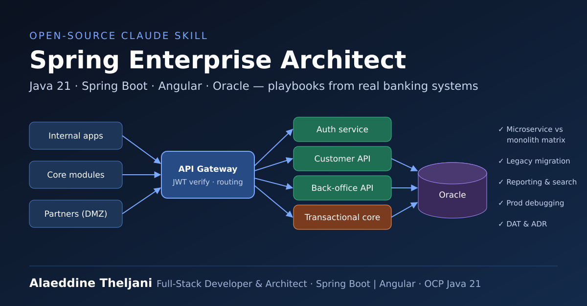

<p align="center">
  
</p>

# Spring Enterprise Architect — a Claude Skill

> Turn Claude into a senior **Java 21 / Spring Boot / Angular architect** for regulated, on-premise enterprise systems — distilled from real banking modernization and API-platform projects.

    

## Why this skill?

Generic AI answers say "use microservices" and stop there. Real enterprise work is about trade-offs:
*which* capability becomes a service, which money-moving flow must stay in one transaction, how to migrate 20-year-old Oracle Forms without losing a business rule, and why your Hikari pool is exhausted at 10:42 every morning.

This skill packages those decisions into playbooks Claude follows automatically.

## What it does

| Workflow | What you get |
|---|---|
| 🏛️ **Design an API platform** | Bounded contexts, microservice-vs-monolith matrix, gateway & JWT auth pattern, delivery lots |
| 🔄 **Modernize legacy** | 7-phase plan for Oracle Forms / Reports / scripts → Spring Boot + Angular |
| 📄 **Reporting module** | One-report-one-slice pattern with JasperReports (PDF/XLSX) |
| 🔎 **Multi-criteria search** | Composable JPA `Specification`s + PrimeNG lazy tables |
| 🧐 **Code / architecture review** | Blocking / Should fix / Nice to have, with concrete fixes |
| 🐛 **Production debugging** | Catalogue of real failures: connection leaks, `anonymousUser`, Oracle null binding, Lombok × Jasper… |
| 📝 **Documentation** | Technical Architecture Document (DAT) and ADR templates |

## Structure

```
spring-enterprise-architect/
├── SKILL.md                         # entry point: principles + workflows
├── references/
│   ├── architecture-decisions.md    # decision matrix, topology, auth, pooling
│   ├── legacy-migration.md          # Forms/Reports → Spring Boot + Angular
│   ├── reporting-module.md          # JasperReports vertical slice
│   ├── dynamic-search.md            # JPA Specifications + PrimeNG
│   └── troubleshooting.md           # known-failure catalogue
└── templates/
    ├── architecture-document.md     # DAT template
    └── adr.md                       # Architecture Decision Record
```

## Install

**Claude.ai / Claude app** — download `spring-enterprise-architect.zip` from [Releases](../../releases), then *Settings → Capabilities → Skills → Upload skill*.

**Claude Code**
```bash
git clone https://github.com/alaeddineth/spring-enterprise-architect-skill.git
cp -r spring-enterprise-architect-skill/spring-enterprise-architect ~/.claude/skills/
```

**Claude API / Agent SDK** — upload the folder as a custom skill (see Anthropic's Skills docs).

## Try it

```
Design an API platform for 3 core applications and 2 external partners, on-prem, team of 4.
Should customer lookup and loan disbursement be microservices?
```
```
Migrate this Oracle Forms trigger to a Spring Boot service: <paste PL/SQL>
```
```
My Hikari pool is exhausted after a few hours. Here's my config and stack trace…
```

## Contributing

Issues and PRs welcome — especially new entries for `troubleshooting.md` from your own production war stories.

## Author

**Alaeddine Theljani** — Full-Stack Developer & Software Architect (Spring Boot | Angular) · OCP Java 21 · PhD candidate in cybersecurity · IT trainer
[LinkedIn](https://www.linkedin.com/in/<your-linkedin-handle>) · [GitHub](https://github.com/alaeddineth)

## License

MIT — see [LICENSE](LICENSE).
