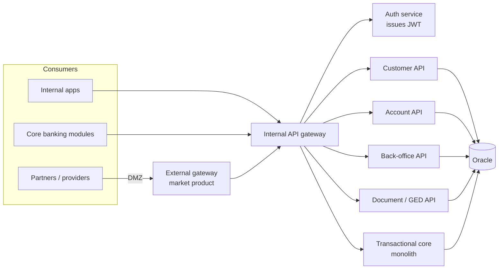

# Architecture decisions playbook

## 1. Microservice or module? Decision matrix

Score each bounded context. **≥ 4 "yes" → microservice candidate. Otherwise → module in a modular monolith.**

| Question | Yes → favours microservice |
|---|---|
| Is it consumed by ≥ 2 independent applications or partners? | ✅ |
| Does it have a different release cadence from its neighbours? | ✅ |
| Does it need independent scaling (load profile differs)? | ✅ |
| Can it own its data without cross-context transactions? | ✅ |
| Is there a named team/person who will own it long-term? | ✅ |
| Is the business flow **chained & transactional** (debit + credit + position + accounting entry)? | ❌ keep monolithic |
| Is the team < 3 devs or new to distributed systems? | ❌ start modular monolith |

**Rule of thumb:** generic, read-heavy, reusable capabilities (customer lookup, product
catalogue, reference data, document storage, auth) → services. Complex money-moving
workflows → one transactional boundary.

## 2. Reference topology for an on-prem enterprise API platform

- One repository (mono-repo) with a `common` module (error model, security, audit, DTO base) avoids drift early.
- **Internal gateway** can be built in-house (Spring Cloud Gateway); buy a market product only where you expose to customers/partners in the DMZ (rate limiting, developer portal, WAF).
- Gateway in dev = Spring Cloud Gateway; pre-prod/prod = platform ingress/gateway managed by the system team. Developers don't own Kubernetes manifests if a platform team exists.

## 3. Authentication pattern (no IdP available)

1. Client → Gateway: `POST /auth/signin {login, password}`.
2. Gateway forwards to **Auth service** → validates against directory/HR → issues signed JWT (short TTL) + refresh token. Claims: `sub`, `roles`, `apps`/`menuCodes`.
3. Gateway verifies signature on every call; **each service verifies again** (defense in depth, zero-trust inside the LAN).
4. Authorization by habilitation codes (`codeApp`, `codeMenu`) → frontend shows only allowed apps/menus; backend enforces with `@PreAuthorize`.
5. Prefer asymmetric keys (RS256/ES256) so services only need the public key.

If an IdP (Keycloak, Entra ID) becomes available later, the contract (JWT + claims) stays the same — that's the reversibility you want.

## 4. Connection pooling with Oracle

- Start with **HikariCP** (Spring default). Size: `connections ≈ (cores × 2) + effective spindles`; usually 10–20 per instance is plenty. Sum across all instances must fit the DB's session limit.
- Move to **Oracle UCP** when you need FAN/FCF, RAC load balancing, or a DB proxy that requires it.
- Always enable leak detection in non-prod: `spring.datasource.hikari.leak-detection-threshold=20000`.

## 5. Cross-cutting checklist

- [ ] Error model: RFC 7807 `ProblemDetail` everywhere
- [ ] Versioning: `/api/v1/...`; never break a published contract
- [ ] Pagination: `page`, `size`, `sort`; max size enforced server-side
- [ ] Correlation ID propagated gateway → services → logs
- [ ] Audit trail for every state change (who, when, before/after)
- [ ] OpenAPI spec per service, published in a catalogue with the **owner's name**
- [ ] Secrets outside the repo (vault / env), never in `application.yml`
